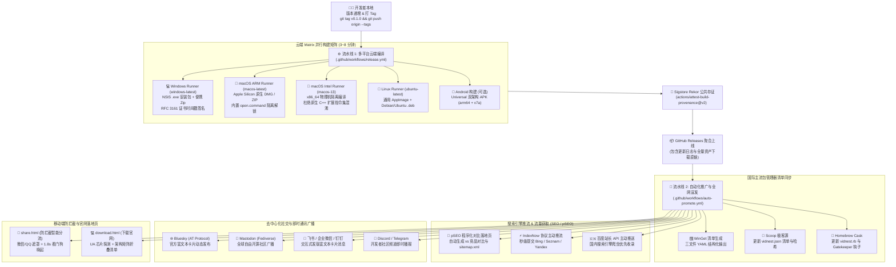

# 🚀 VidNest 自动化发版与全渠道推广分发系统 (AutoDeploy)

> **定位**: VidNest 工业级、无人值守的全自动编译、代码签名、多渠道分发与全网推广自动化系统。  
> **设计哲学**: **Local-First & One-Tag Pipeline** —— 开发者仅需在本地终端执行一次 `git push tag`，后续多平台云端编译、代码签名存证、包管理器同步、搜索引擎秒级收录、社交网络全自动广播全部交由云端自动化流水线接管。

---

## 🗺️ 一、全景架构与工作流 (System Architecture)



---

## 📂 二、目录结构与文件用途说明 (Directory Structure)

```text
autodeploy/
├── README.md                          # 本系统完整使用与维护说明文档
├── package.json                       # 独立工程配置，提供快捷脚本与统一测试入口
├── scripts/                           # 核心自动化任务脚本库 (ESM 模块规范)
│   ├── utils.mjs                      # 基础通用工具库 (日志、HTTP 客户端、元数据提取、DRY_RUN 探测)
│   ├── generate-package-manifests.mjs # 资产哈希流式提取与 WinGet/Scoop/Homebrew 清单生成器
│   ├── seo-push.mjs                   # 搜索引擎秒级推流脚本 (IndexNow + 百度站长主动推送)
│   ├── generate-pseo-pages.mjs        # 程序化 SEO (pSEO) 竞品对比落地页与 sitemap 生成器
│   ├── broadcast-release.mjs          # 去中心化社交网络与 IM 机器人多渠道发版广播脚本
│   ├── mac-gatekeeper-helper.sh       # macOS Sequoia/Sonoma Gatekeeper 隔离解锁助手 (open.command)
│   └── self-sign-windows.ps1          # Windows 自动化 Authenticode 代码自签名与 RFC 3161 时间戳脚本
├── templates/                         # 落地页与协议验证模板库
│   ├── share.html                     # 移动端扫码防拦截与智能分流落地页 (微信/QQ遮罩 + 看门狗唤醒)
│   ├── download.html                  # 现代化响应式产品下载官网模板 (UA 智能探测 + 芯片架构矩阵)
│   └── indexnow-key.txt               # IndexNow 协议根目录域名验证密钥占位文件
├── workflows/                         # GitHub Actions 工作流备份模板
│   ├── release.yml                    # 多平台并行构建与发布工作流
│   └── auto-promote.yml               # 自动化推广与多渠道分发工作流
└── manifests/                         # 自动化生成的各包管理器配置产物 (按版本归档)
    ├── winget/                        # Microsoft WinGet 三文件清单 (installer/yaml/locale)
    ├── scoop/                         # Windows Scoop 极客源 JSON 清单
    └── homebrew/                      # macOS Homebrew Cask Ruby 脚本 (vidnest.rb)
```

### 各核心文件职责详述

| 文件路径 | 语言/类型 | 核心职责 |
|---|---|---|
| [`templates/share.html`](file:///Users/hou/hqx/hubproject/VidNest/autodeploy/templates/share.html) | HTML5 / JS | 移动端扫码专用落地页。自动探测微信/QQ 浏览器并浮现右上角半透明指引遮罩；解析 URL 参数并尝试通过 `vidnest://open` 或 Android Intent 唤醒客户端；启动 1.8s 看门狗超时机制，未唤醒则优雅平滑展示产品特性与 Android APK / 桌面端官网直达直链。 |
| [`templates/download.html`](file:///Users/hou/hqx/hubproject/VidNest/autodeploy/templates/download.html) | HTML5 / CSS3 / JS | 现代化响应式下载官网模板。契合 VidNest 黑夜科技质感 (`#080c14`)；基于 User-Agent 与 WebGL 渲染器精准识别系统及芯片架构 (Apple Silicon M系列 vs Intel / Windows x64 / Linux)，高亮推荐主下载按钮；提供多版本架构折叠清单与一键复制 SHA-256 哈希位。 |
| [`templates/indexnow-key.txt`](file:///Users/hou/hqx/hubproject/VidNest/autodeploy/templates/indexnow-key.txt) | Plain Text | IndexNow 协议鉴权密钥占位文件。部署至静态站点根目录，供微软 Bing、Seznam 等搜索引擎爬虫校验站点所有权。 |
| [`scripts/generate-package-manifests.mjs`](file:///Users/hou/hqx/hubproject/VidNest/autodeploy/scripts/generate-package-manifests.mjs) | Node.js ESM | 自动化下载或读取 Release 构建构件，流式计算 SHA-256 哈希，生成 Microsoft WinGet 三文件清单、Scoop 清单与 Homebrew Cask 脚本。 |
| [`scripts/seo-push.mjs`](file:///Users/hou/hqx/hubproject/VidNest/autodeploy/scripts/seo-push.mjs) | Node.js ESM | 读取站点 URL 清单，调用 IndexNow API (Bing/Seznam) 与百度站长主动推送接口，实现新版本发布后秒级收录。 |
| [`scripts/generate-pseo-pages.mjs`](file:///Users/hou/hqx/hubproject/VidNest/autodeploy/scripts/generate-pseo-pages.mjs) | Node.js ESM | 程序化批量生成对比 Eagle、剪映、Jellyfin 等竞品的长尾对比静态 HTML，自动更新 `sitemap.xml` 与 `robots.txt`。 |
| [`scripts/broadcast-release.mjs`](file:///Users/hou/hqx/hubproject/VidNest/autodeploy/scripts/broadcast-release.mjs) | Node.js ESM | 广播发版动态至 Bluesky (AT Protocol)、Mastodon (Fediverse)、飞书/钉钉/企业微信及 Discord/Telegram。 |
| [`scripts/mac-gatekeeper-helper.sh`](file:///Users/hou/hqx/hubproject/VidNest/autodeploy/scripts/mac-gatekeeper-helper.sh) | Shell (Bash) | 生成打包随行的 `open.command`，一键清除 macOS Gatekeeper `com.apple.quarantine` 扩展属性，解决“未受信任/文件已损坏”提示。 |
| [`scripts/self-sign-windows.ps1`](file:///Users/hou/hqx/hubproject/VidNest/autodeploy/scripts/self-sign-windows.ps1) | PowerShell | Windows 平台调用 `signtool.exe`，加盖 DigiCert / Sectigo RFC 3161 时间戳，帮助自签名应用累积 SmartScreen 信誉。 |

---

## 🔑 三、GitHub Repository Secrets 配置清单

为了让流水线在无人工干预的情况下顺利完成全渠道分发与宣发，请前往 GitHub 仓库：  
`Settings` ➔ `Secrets and variables` ➔ `Actions` ➔ `Repository secrets` 配置以下环境变量：

### 1. 核心与包管理器凭证 (Core & Distribution)

| Secret 键名 | 必填 | 作用描述与获取指引 |
|---|:---:|---|
| `GITHUB_TOKEN` | **系统内置** | GitHub Actions 自动提供。需确保在 `Settings` ➔ `Actions` ➔ `General` 中将 **Workflow permissions** 设置为 `Read and write permissions`。 |
| `WINGET_TOKEN` | 可选 | 用于向 `microsoft/winget-pkgs` 提交包更新 PR 的个人访问令牌 (PAT, 勾选 `public_repo`)。未配置时将保存清单至 Artifact。 |

### 2. 搜索引擎秒级推流凭证 (SEO Push)

| Secret 键名 | 必填 | 作用描述与获取指引 |
|---|:---:|---|
| `INDEXNOW_KEY` | 推荐 | IndexNow API 认证密钥 (32 位 Hex 字符)。可在 [IndexNow 官网](https://www.indexnow.org/) 免费生成。内容必须与 `templates/indexnow-key.txt` 完全一致。 |
| `BAIDU_PUSH_TOKEN` | 可选 | 百度站长平台 (data.zz.baidu.com) 提供的站长主动推送准入密钥。国内站点推荐配置。 |
| `SITE_URL` | 推荐 | 官网主站根域名 (默认 `https://vidnest.app`)。用于拼接推流 URL 与 sitemap.xml。 |

### 3. 去中心化社交与社区广播凭证 (Social Broadcast)

| Secret 键名 | 必填 | 作用描述与获取指引 |
|---|:---:|---|
| `BLUESKY_HANDLE` | 可选 | Bluesky 用户句柄 (如 `vidnest.bsky.social`)。 |
| `BLUESKY_APP_PASSWORD` | 可选 | Bluesky 专用应用密码 (在 Bluesky 网页设置 ➔ `App Passwords` 中生成，无需主密码)。 |
| `MASTODON_INSTANCE_URL` | 可选 | Mastodon 实例地址 (如 `https://mastodon.social`)。 |
| `MASTODON_ACCESS_TOKEN` | 可选 | Mastodon 机器人应用的 API Access Token (在实例后台 Preferences ➔ Development 中创建)。 |

### 4. 即时通讯与团队机器人凭证 (Team Webhooks)

| Secret 键名 | 必填 | 作用描述与获取指引 |
|---|:---:|---|
| `FEISHU_WEBHOOK_URL` | 可选 | 飞书群自定义机器人 Webhook 直链。发版后自动推送精美交互式发版卡片。 |
| `DINGTALK_WEBHOOK_URL` | 可选 | 钉钉群自定义机器人 Webhook 直链。 |
| `DISCORD_WEBHOOK_URL` | 可选 | Discord 频道 Webhook 直链。自动推送 Rich Embed 发版资讯。 |
| `TELEGRAM_BOT_TOKEN` | 可选 | Telegram Bot API Token (由 `@BotFather` 创建)。 |
| `TELEGRAM_CHAT_ID` | 可选 | Telegram 发布目标频道或群组 Chat ID (如 `@vidnest_news` 或 `-100xxxx`)。 |

> [!NOTE]
> 所有推广与广播脚本均内置了**优雅降级 (Graceful Degradation)** 机制。若某个平台的凭证未设置，流水线会自动打印 `[SKIPPED]` 跳过该通道，绝对不会导致整体构建任务失败报错。

---

## 🧪 四、本地 Dry-Run 测试命令 (Local Testing)

在正式触发 GitHub Actions 之前，您可以在本地进行完整的离线预演，验证包管理器清单生成、SEO 模拟推流与社交广播输出。

进入 `autodeploy` 目录：
```bash
cd /Users/hou/hqx/hubproject/VidNest/autodeploy
```

### 1. 一键执行全量测试套件 (Recommended)
```bash
npm run test:all
```
该命令会自动开启 `DRY_RUN=true` 环境变量，顺序运行全部 4 项任务：
- **`manifests`**: 使用模拟数据生成 WinGet YAML、Scoop JSON 与 Homebrew Cask 脚本；
- **`seo`**: 扫描站点 URL 并模拟提交至 IndexNow 和百度 API；
- **`broadcast`**: 预览各社交平台（Bluesky、Mastodon）与即时通讯机器人的发版消息卡片；
- **`pseo`**: 程序化生成 4 篇竞品对比落地页、`index.html` 与 `sitemap.xml`。

### 2. 单独调试指定任务
```bash
# 单独测试包清单生成 (支持离线模式)
node scripts/generate-package-manifests.mjs --dry-run

# 单独测试 SEO 推流 (模拟推流模式)
DRY_RUN=true node scripts/seo-push.mjs

# 单独测试社交广播 (带指定模拟版本)
DRY_RUN=true RELEASE_VERSION=v0.1.0 node scripts/broadcast-release.mjs

# 单独生成 pSEO 页面至指定目录
DRY_RUN=true node scripts/generate-pseo-pages.mjs --out-dir ./dist_test
```

### 3. 本地验证落地页模板渲染
您可以使用任何轻量静态服务器在本地预览 `templates/share.html` 与 `templates/download.html`：
```bash
npx serve templates/
# 或使用 Python 内置服务器:
python3 -m http.server 8080 --directory templates/
```
- 访问 `http://localhost:8080/share.html`：测试移动端扫码体验、微信遮罩模拟与 1.8s 看门狗超时降级面板；
- 访问 `http://localhost:8080/download.html`：测试操作系统/芯片架构自动探测、折叠面板与 SHA-256 哈希复制功能。

---

## 🚀 五、生产发版流程与操作指引 (Production Release Flow)

VidNest 采用严格的 Git Tag 驱动发布体系。发布新版本仅需以下标准三步：

### 第 1 步：递增版本号并提交
确保 `package.json`、`src-tauri/Cargo.toml` 以及 `src-tauri/tauri.conf.json` 中的版本号保持同步：
```bash
# 检查当前工作区变更
git status

# 提交版本升级与更新日志
git add .
git commit -m "chore(release): bump version to v0.1.0"
git push origin main
```

### 第 2 步：打 Tag 并推送到 GitHub (核心触发点)
```bash
# 创建轻量或附注标签
git tag v0.1.0 -m "Release v0.1.0: Local Video Intelligence First Stable Release"

# 推送标签至 GitHub 仓库
git push origin --tags
```

### 第 3 步：云端流水线自动执行 (自动接管)
一旦 Tag 推送成功，GitHub Actions 将依次触发两级流水线：
1. **`release.yml` (约 3~8 分钟)**：
   - 四大环境矩阵并发编译 (Windows NSIS、macOS ARM64、macOS Intel x64、Linux AppImage/deb)；
   - 自动生成 Sigstore Rekor 链上存证；
   - 自动上线 GitHub Release `v0.1.0` 并附带全部跨平台构建安装包。
2. **`auto-promote.yml` (约 1~2 分钟)**：
   - 监听 Release 发布事件，触发全自动宣发；
   - 提取构建物哈希，生成 WinGet、Scoop、Homebrew 清单；
   - 调用 IndexNow 主动提交 Bing / Seznam 索引；
   - 向 Bluesky、Mastodon 及配置的团队机器人派发带有下载直链的发版卡片。

---

## 🛡️ 六、工业级避坑与注意事项 (Production Checklist)

1. **macOS Gatekeeper 拦截绕过**：
   - 未配置 Apple 开发者证书 (\$99/年) 的应用在 macOS Sequoia / Sonoma 上会被拦截报“应用已损坏”。
   - 系统已内置 [`scripts/mac-gatekeeper-helper.sh`](file:///Users/hou/hqx/hubproject/VidNest/autodeploy/scripts/mac-gatekeeper-helper.sh)，在生成 DMG 时随包附带 `open.command`，用户双击即可自动执行 `xattr -rd com.apple.quarantine` 解锁。
2. **Windows 覆盖安装文件占用**：
   - Tauri / Rust 进程退出可能有微小延迟。NSIS 安装器配置了静默更新宏，建议在后续发版中保持 `/S` 静默安装参数。
3. **微信环境直接下载拦截**：
   - 微信内置浏览器全面拦截 `.apk` 直链与自定义 Scheme。
   - 所有对外宣传二维码必须指向 `share.html`。页面内建的微信/QQ 环境检测遮罩会无缝引导用户使用系统默认浏览器打开。
4. **IndexNow Key 验证**：
   - 确保静态网站发布时，`templates/indexnow-key.txt` 复制到了 Web 根目录下，且文件名与内容与 `INDEXNOW_KEY` 环境变量严格匹配。
5. **WinGet 自动化提 PR 规范**：
   - WinGet 要求安装器支持静默参数。导出的 YAML 清单已默认注入 `InstallerSwitches: { Silent: /S, SilentWithProgress: /S }`，符合微软官方机器人的自动化合并标准。

---

> VidNest Core Engineering · Built with Tauri 2, Rust & Vue 3 · 2026
