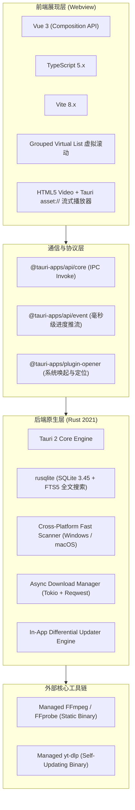

# 📚 VidNest 核心工程知识库 (VidNest Wiki)

> **定位**: VidNest (Local Video Intelligence) 核心架构、算法设计、媒体流处理、自动化发布与应用内升级官方工程文档库。

---

## 🗺️ 知识库导航目录 (Table of Contents)

| 章节文档 | 核心内容提要 | 适用场景 |
|---|---|---|
| 📐 [系统架构与设计理念](architecture_and_design.md) | Tauri 2 + Rust + Vue 3 整体架构、进程间通信 (IPC) 协议、Local-First 隐私哲学 | 架构设计、新功能拓展、技术选型参考 |
| ⚡ [全盘极速扫描与毫秒级索引](full_disk_scanner_and_indexing.md) | Windows & macOS 跨平台黑名单过滤、零开销深度遍历、快速文件哈希、SQLite FTS5 毫秒搜 | 扫描引擎调优、索引机制排查 |
| 🎬 [媒体库与独立弹窗播放器](video_library_and_player.md) | 按天时间线切分、Grouped Virtual List 虚拟滚动渲染、`asset:` 协议 HTTP Range 分块寻道播放器 | 媒体库界面交互、前端性能优化、播放器开发 |
| 🔄 [应用内差分增量升级指南](in_app_differential_update.md) | 语义化版本比对、差分增量补丁（节约 78% 流量）、分块流式下载毫秒级进度推流、应用内免跳出重启 | 客户端热更与版本升级、分发测试 |
| 📥 [yt-dlp 视频下载与混流引擎](ytdlp_and_downloader.md) | DASH 独立 4K 视频/音频流解析混流、`--ffmpeg-location` 本地静态二进制注入、异步管道流式排水防死锁 | 在线视频解析、第三方依赖打包 |
| 🚀 [autodeploy 全自动发版指南](autodeploy_guide.md) | 多平台矩阵编译、Sigstore 公共存证、包管理器清单自动生成、IndexNow 秒级推流、多群聊 Webhook 广播 | CI/CD 流水线维护、自动化运营推广 |
| 🌐 [全渠道推广分发实战蓝皮书](universal_release_and_promotion_blueprint.md) | 企业级/开源软件发版与增长工程通用实战蓝皮书（完整理论体系与实战策略） | 全渠道增长与营销实践 |

---

## 🛠️ 项目技术栈全景 (Tech Stack)



---

## 快速上手与常用开发指令

```bash
# 1. 运行前端构建检查
npm run build

# 2. 运行 Rust 后端全量单元测试
cd src-tauri && cargo test

# 3. 启动桌面端开发调试环境
npm run tauri dev

# 4. 执行 autodeploy 全链路离线测试
cd autodeploy && npm run test:all

# 5. 打 Tag 触发全平台自动云端构建与发布
git tag v0.1.0 && git push origin --tags
```
