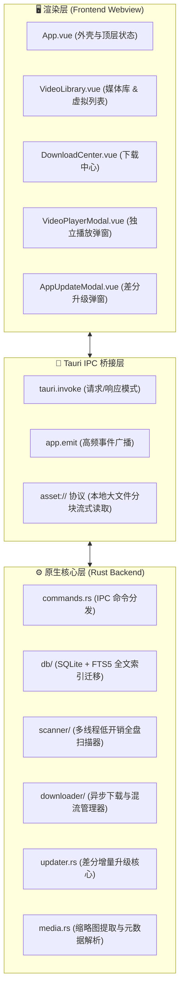

# 📐 VidNest 系统架构与设计理念 (Architecture & Design)

VidNest (Local Video Intelligence) 是一套采用 **Local-First（本地优先）** 哲学的现代桌面端视频智能管理、解析与全渠道分发工作台。

---

## 🏛️ 一、整体分层架构

VidNest 采用前后端分离但深度紧密的 Tauri 2 混合桌面架构：

---

## 🔒 二、Local-First（本地优先）设计准则

1. **零强制云端上传**：
   - 所有的视频文件索引、元数据解析（FFprobe）、FTS5 全文搜索、缩略图提取均在用户本地计算机硬件上完成。
   - 用户的大体积素材无需同步到任何外部云服务器，保障创作者的商业机密与隐私安全。
2. **极低资源开销**：
   - 相比传统 Electron 应用动辄占用 500MB~1GB 内存，Tauri 2 利用系统原生 WebKit/WebView2 渲染，后台常驻内存控制在 50MB~90MB 以内。
3. **原生硬件加速**：
   - 本地视频播放通过 `asset:` 本地协议桥接，直接调用 GPU 硬件视频解码器（VideoToolbox / DXVA2 / VAAPI），4K 60FPS 极速播放且 CPU 占用极低。

---

## 🔌 三、IPC 接口与状态管理设计

### 1. 结构化命令 (Commands)
- 所有 Rust 命令必须以 `#[tauri::command]` 标注，并通过 `Result<T, String>` 返回强类型结果；
- 前端通过 TypeScript 接口全量类型覆盖，严禁使用 `any`。

### 2. 高频事件推流 (Event Streaming)
在扫描、下载和更新三大高耗时任务中，严禁前端轮询，统一采用异步事件推流：
- **全盘扫描进度**：`scan-progress`（携带当前处理文件、已处理数、当前阶段）；
- **下载任务进度**：`download-progress`（携带瞬时速度、ETA、百分比、已下载字节数）；
- **应用升级进度**：`app-update-progress`（携带下载速度、百分比、校验状态）。

### 3. 本地存储布局
- 数据目录自动适配操作系统规范：
  - **macOS**：`~/Library/Application Support/LocalVideoIntelligence/`
  - **Windows**：`%LOCALAPPDATA%\LocalVideoIntelligence\`
- 包含文件：
  - `vidnest.db`：SQLite 数据库文件（包含 `videos`、`videos_fts` 全文索引表、`download_tasks` 任务表）；
  - `bin/`：托管的独立可升级二进制文件（`ffmpeg`, `ffprobe`, `yt-dlp`）；
  - `thumbnails/`：视频提取的高清帧缩略图缓存。
