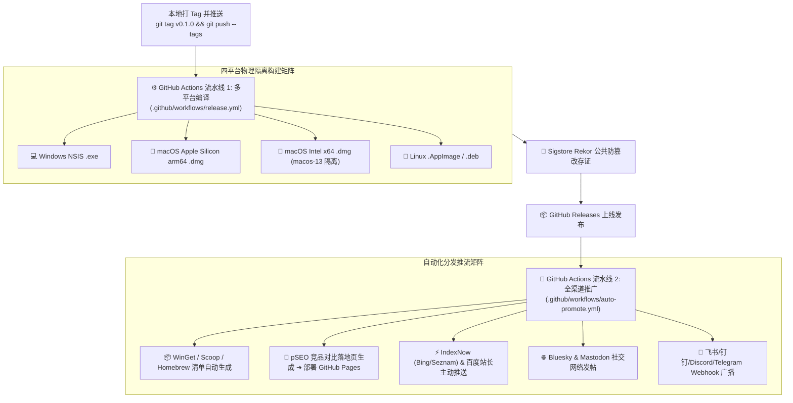

# 🚀 autodeploy 全自动发版与全渠道推广实践指南 (Autodeploy Manual)

基于 [`wiki/universal_release_and_promotion_blueprint.md`](universal_release_and_promotion_blueprint.md)，VidNest 在工程根目录的 [`autodeploy/`](file:///Users/hou/hqx/hubproject/VidNest/autodeploy) 目录下建立了开箱即用的工业级全自动发版与分发系统。

---

## 🗺️ 一、系统全景流程图



---

## 📂 二、`autodeploy` 目录与脚本结构

```text
autodeploy/
├── package.json                           # 独立脚本管理与一键测试入口
├── README.md                              # 详细配置手册
├── workflows/                             # 核心流水线源文件
│   ├── release.yml                        # 多平台云端编译工作流
│   └── auto-promote.yml                   # 全渠道自动化推广工作流
├── scripts/                               # 核心 ESM 脚本集
│   ├── generate-package-manifests.mjs     # 计算产物 SHA256，生成 WinGet/Scoop/Homebrew 清单
│   ├── seo-push.mjs                       # IndexNow (Bing) 与百度站长秒级推流
│   ├── broadcast-release.mjs              # Bluesky, Mastodon, 飞书/钉钉/Discord/TG 广播
│   ├── generate-pseo-pages.mjs            # 程序化 SEO (pSEO) 竞品对比落地页与 sitemap 生成
│   ├── mac-gatekeeper-helper.sh           # 生成随包分发的 open.command 免隔离脚本
│   └── self-sign-windows.ps1              # Windows Authenticode 时间戳自签名模板
├── templates/                             # 落地页与鉴权模板
│   ├── share.html                         # 微信/QQ 扫码防拦截与智能唤起落地页
│   ├── download.html                      # 官网多架构下载页模板
│   └── indexnow-key.txt                   # IndexNow 域名验证占位符
└── manifests/                             # 生成的包管理器清单存放位置
```

---

## 🔑 三、GitHub Repository Secrets 推荐配置表

进入 GitHub 仓库页面：`Settings` ➔ `Secrets and variables` ➔ `Actions` ➔ `New repository secret`：

| Secret 键名 | 所属渠道 | 用途描述 | 缺失时的默认行为 |
|---|---|---|---|
| `GITHUB_TOKEN` | GitHub | 创建 Releases、提审 WinGet PR | GitHub Actions 自动默认提供 |
| `INDEXNOW_KEY` | 必应 / Seznam | IndexNow 协议域名验证 Key | 友好警告并跳过，不阻断发版 |
| `BAIDU_PUSH_TOKEN` | 百度搜索 | 百度站长主动推送 Token | 友好警告并跳过，不阻断发版 |
| `BLUESKY_HANDLE` | Bluesky | 去中心化社交网络账号 (e.g. `yourname.bsky.social`) | 友好警告并跳过 |
| `BLUESKY_APP_PASSWORD` | Bluesky | 在设置中生成的独立应用密码 | 友好警告并跳过 |
| `MASTODON_ACCESS_TOKEN` | 长毛象 | Fediverse 访问令牌 | 友好警告并跳过 |
| `FEISHU_WEBHOOK_URL` | 飞书 / Lark | 团队群聊交互式富文本发版卡片 Webhook | 友好警告并跳过 |
| `DINGTALK_WEBHOOK_URL` | 钉钉 | 钉钉机器人 Markdown 消息 Webhook | 友好警告并跳过 |
| `DISCORD_WEBHOOK_URL` | Discord | Discord 社区频道 Embed 通知 Webhook | 友好警告并跳过 |
| `TELEGRAM_BOT_TOKEN` | Telegram | Telegram 机器人 Token | 友好警告并跳过 |
| `TELEGRAM_CHAT_ID` | Telegram | Telegram 接收频道的 Chat ID | 友好警告并跳过 |

> **提示**：所有外部渠道均已集成**优雅降级（Graceful Degradation）**机制。若未配置某些 Secret，工作流只会友好跳过对应渠道，绝不会导致核心编译构建或 Release 上线失败。

---

## 🧪 四、本地 Dry-Run 联调指令

在本地开发机中，无需实际推送或消耗外部 Token 即可完整验证所有自动化脚本：

```bash
# 进入 autodeploy 目录并执行全链路离线测试
cd autodeploy
npm run test:all
```
- 会自动以 `--dry-run` 模式模拟生成 WinGet / Scoop / Homebrew 清单；
- 会自动模拟 IndexNow 与百度推送载荷；
- 会自动渲染并打印 6 大社交/群聊渠道的富文本卡片；
- 会自动生成 7 个 pSEO 落地页与 sitemap.xml。
