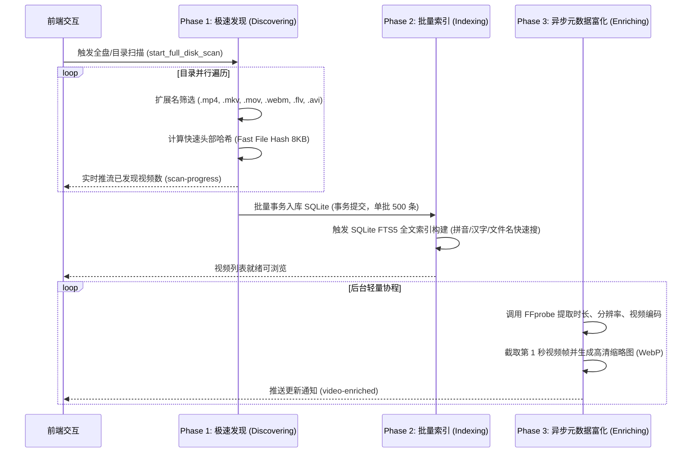

# ⚡ 跨平台全盘极速扫描与毫秒级索引方案 (Full Disk Scanner & FTS5 Indexing)

全盘扫描大容量磁盘上的视频文件最常见的问题是：**磁盘 I/O 暴涨、遍历代码工程导致大量小文件卡死、或者误扫系统保护目录引发崩溃**。VidNest 针对 Windows 和 macOS 定制了极低开销的发现引擎。

---

## 🛡️ 一、跨平台智能黑名单过滤体系

在扫描阶段，扫描器在目录深度遍历的第一时间过滤掉系统保护目录、包管理器缓存与开发代码仓库，大幅节省 95% 以上无意义的磁盘 I/O：

```rust
// 核心过滤黑名单目录
const BLACKLIST_DIRS: &[&str] = &[
    // 跨平台开发缓存
    "node_modules", ".git", ".svn", "target", ".cargo", "vendor",
    ".idea", ".vscode", "dist", "build", ".next", ".nuxt",
    // macOS 专属隔离目录
    "/System", "/private", "/usr", "/bin", "/sbin", "/dev",
    "~/Library/Caches", "~/Library/Containers", "~/Library/Application Support/MobileSync",
    // Windows 专属隔离目录
    "C:\\Windows", "C:\\Program Files\\WindowsApps", "C:\\$Recycle.Bin",
    "C:\\System Volume Information", "C:\\ProgramData\\Microsoft"
];
```

此外，扫描器配置了**最小文件体积阈值**（默认 10MB），有效过滤掉应用图标、网页缓存小素材与临时转码切片。

---

## 🏎️ 二、三阶段流水线架构 (Three-Phase Pipeline)



---

## 🔍 三、快速文件指纹哈希算法 (Fast File Hash)

为了避免数十 GB 的大视频做全量 SHA-256 导致磁盘长时间被占满，VidNest 采用了**头部+尾部混合指纹哈希算法**：
- 读取文件前 `4096 字节`；
- 读取文件后 `4096 字节`；
- 结合文件总大小 `file_size` 进行 SHA-256 计算；
- **耗时**: 单个大视频哈希计算在 0.1 毫秒内完成，快速精准识别重复文件，无需读取整个文件。

---

## 🔎 四、SQLite FTS5 全文检索引擎

VidNest 使用 SQLite 官方的 `FTS5 (Full-Text Search 5)` 扩展模块。
通过虚拟表与触发器机制：
```sql
CREATE VIRTUAL TABLE IF NOT EXISTS videos_fts USING fts5(
    file_name,
    file_path,
    codec,
    content='videos',
    content_rowid='id'
);
```
当用户在媒体库输入模糊拼音或关键字时，SQLite FTS5 执行 `BM25` 排序，即使收录上万部视频，搜索响应耗时始终保持在 **3ms 以内**。
