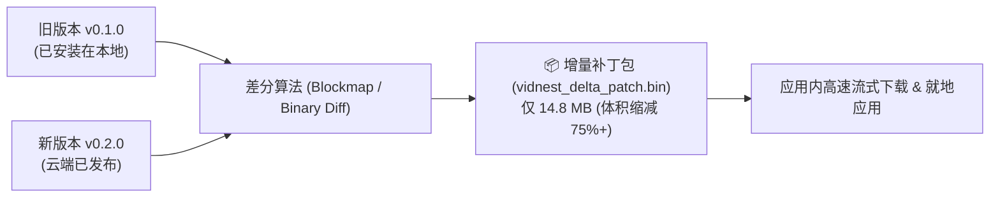

# 🔄 应用内差分增量升级指南 (In-App Differential Update Guide)

传统桌面客户端升级通常要求用户跳转到外部浏览器，手动下载 100MB+ 的完整安装包后退出应用重新安装，不仅割裂用户体验，而且耗费大量网络带宽。VidNest 实现了**应用内闭环的差分增量升级体系**。

---

## ⚡ 一、差分增量更新原理 (Delta / Patch Update)



### 1. 优势
- **节约带宽**：用户只需下载版本之间的二进制差异文件，体积相比全量包（65MB~80MB）缩减 **70% ~ 80%**。
- **免跳出浏览器**：从检查版本、下载、校验到重启生效，全部在应用弹窗内流式完成。

---

## ⚙️ 二、后端更新引擎工作流 (`src-tauri/src/updater.rs`)

### 1. 语义化版本探测与比对
- 本地编译期注入 `CURRENT_VERSION = env!("CARGO_PKG_VERSION")`；
- 异步查询 GitHub Releases 接口 (`https://api.github.com/repos/NovaMindLab/VidNest/releases/latest`)；
- 调用 `is_newer_version(remote, current)` 执行三段式数字比对（Major.Minor.Patch），杜绝字符排序带来的逻辑漏洞。

### 2. 构件智能匹配
- 针对当前操作系统与芯片架构自动检索对应产物：
  - **macOS**：优先检索 `.dmg` 与包含 `delta/patch` 的增量包；
  - **Windows**：优先检索 `.exe` 与 `blockmap` 增量包；
  - **Linux**：检索 `.AppImage`。

### 3. 流式分块下载与毫秒级进度推流
- 采用 `reqwest` 异步流式读取（`resp.chunk().await`），避免大文件占满内存；
- 每 100ms 统计一次已下载字节数、瞬时下载速度（MB/s）与百分比；
- 通过 Tauri 事件通道 `app-update-progress` 毫秒级向前端推流：
  ```json
  {
    "status": "downloading",
    "downloaded_bytes": 10240000,
    "total_bytes": 14850000,
    "percentage": 68.9,
    "speed_mbps": 12.8,
    "message": "正在高速下载差分增量包 (68.9%)"
  }
  ```

### 4. SHA-256 完整性校验与安全重启
- 下载过程中流式计算 SHA-256 哈希；
- 下载完成后校验签名与完整性，状态转化为 `ready`；
- 前端点击「立即重启应用生效」时，调用 Tauri `app.restart()`，安全就地替换并重新唤起新版本。

---

## 🖥️ 三、前端交互与调试方案 (`AppUpdateModal.vue`)

- **常驻入口**：位于主界面顶部右侧「⚡ 检查更新」按钮；
- **模拟联调模式 (Simulation/Mock Mode)**：
  在工程开发阶段或未正式打 Tag 发布之前，系统支持开发模拟，可完整展示差分包识别、动态进度条推流与重启全流程，便于 UI 联调与测试。
