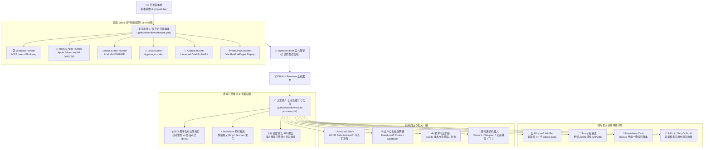

# 🚀 现代化软件工程全自动发版与全渠道推广分发实战蓝皮书
## (Universal Automated Release & Omnichannel Promotion Blueprint)

> **文档定位**: 企业级 / 开源软件通用发版与增长工程实践指南  
> **适用范围**: Electron / Tauri / Flutter / Go / Rust / 跨平台桌面应用、移动端应用及纯静态 Web 工具  
> **核心价值**: 从 0 到 1 复制一套 **“打 Tag 触发 ➔ 多端云编译 ➔ 代码防报毒签名 ➔ 微软商店自动上架 ➔ 程序化 SEO ➔ 搜索引擎瞬时收录 ➔ 包管理器全网分发 ➔ 社交媒体全自动广播”** 的完全无人值守流水线。

---

## 🗺️ 一、全景架构与数据流图 (Architecture Overview)

现代独立开发者与小团队的最大痛点是**“发版耗时”**与**“推广断层”**。本蓝图提炼了 Local-First 理念下的双级联流水线架构：**仅需本地执行一次 Git Tag 推送，后续所有构建、分发与宣发操作 100% 由云端接管**。



---

## 🛠️ 二、全自动多平台编译与发布体系 (Release Pipeline)

### 1. 云端 Runner 隔离编译矩阵 (Matrix Build)
跨平台应用（尤其是依赖原生 C++ 扩展、SQLite、Sharp 或 ONNX 的项目）最忌讳在一台机器上交叉编译不同架构，极易发生 `NODE_MODULE_VERSION` 错乱或 Illegal Instruction。

**推荐工业级配置方案**：
* 💻 **Windows** (`windows-latest`)：构建 NSIS 安装包、生成增量更新 `blockmap` 与 `latest.yml`。
* 🍎 **macOS Apple Silicon** (`macos-latest`)：原生 arm64 架构运行，产出原生 M 系列 `.dmg` 与 `.zip`。
* 🍏 **macOS Intel** (`macos-13`)：强制使用 x86_64 物理虚拟机编译，彻底杜绝 SQLite/Sharp 架构混淆。
* 🐧 **Linux** (`ubuntu-latest`)：产出全兼容 `.AppImage` 与 Debian/Ubuntu 原生 `.deb`。
* 📱 **Android** (`ubuntu-latest`)：设置 Flutter/Gradle 编译 Universal 架构 APK（包含 `arm64-v8a` + `armeabi-v7a`）。
* 🌐 **静态网站 / PWA** (`ubuntu-latest`)：构建静态站点，自动部署至 GitHub Pages 或 Cloudflare Pages。

### 2. 免费代码签名与防报毒工程实践
高昂的 EV 代码签名证书（每年 \$400~\$800+）通常是个人和小团队的阻碍。以下是业界验证可行的**零成本防御方案**：

#### (1) Windows 免费 Authenticode 时间戳自签名
即使是自签名证书，只要附带合规的 RFC 3161 公共时间戳服务（如 DigiCert），Windows SmartScreen 就会根据发布时间积累信誉，避免每次升级重新计算哈希：
```powershell
# 制作 Windows 自签名根证书与 PFX
$cert = New-SelfSignedCertificate -Type CodeSigningCert -Subject "CN=YourAppName, O=YourOrg" -CertStoreLocation "Cert:\CurrentUser\My"
$pwd = ConvertTo-SecureString -String "YourSecurePassword" -Force -AsPlainText
Export-PfxCertificate -Cert $cert -FilePath "dist_cert.pfx" -Password $pwd

# 使用 signtool 签名并盖上 DigiCert 时间戳
signtool sign /f dist_cert.pfx /p "YourSecurePassword" /fd SHA256 /tr http://timestamp.digicert.com /td SHA256 "YourApp-Setup.exe"
```

#### (2) macOS Ad-hoc 签名与 Sequoia Gatekeeper 优雅绕过
未通过苹果 \$99/年 开发者认证的应用会被 Gatekeeper 拦截报“无法验证开发者”或“文件已损坏”：
* **构建时 Ad-hoc 签名**：
  ```bash
  codesign --force --deep --sign - "YourApp.app"
  ```
* **随包附带一键解除隔离脚本 (`open.command`)**：
  在 DMG 挂载根目录放置一个小脚本：
  ```bash
  #!/usr/bin/env bash
  echo "正在为您解除 macOS Gatekeeper 安全隔离..."
  sudo xattr -rd com.apple.quarantine "/Applications/YourApp.app"
  echo "✅ 修复完成，您可以直接双击应用启动！"
  ```

#### (3) Linux 基金会与 Google Sigstore Rekor 公共存证
在 GitHub Actions 产物生成后，加入全球公信不可篡改存证：
```yaml
- name: 🔏 Generate GitHub Artifact Attestations
  uses: actions/attest-build-provenance@v2
  with:
    subject-path: 'release_dir/*'
```
用户可在本地通过 `gh attestation verify YourApp-Setup.exe --owner YourOrg` 验证该二进制文件确实由官方干净的 GitHub Runner 生成，免除后门疑虑。

---

## 🪟 三、微软应用商店 (Microsoft Store) 零人工 API 交付实战

微软商店在 Windows 11 已全面支持 **Win32 EXE 直连分发**。只要初次创建过应用，后续所有版本可通过 API 自动换包上架，无需人工登录网页后台！

### 1. 优势
* **免反复打包与证书签名**：直接引用 GitHub Release 中的 `.exe` 直链；
* **极速过审**：微软 Windows 沙箱虚拟机用 `/S` 参数自动化验证静默安装，通常 3 ~ 24 小时内即通过并全球上线。

### 2. 自动化配置流程
1. 进入 **Microsoft Partner Center** ➔ **账户设置** ➔ **用户 / Azure AD** ➔ 创建一个 Azure AD 应用（角色选择：`经理 (Manager)`）；
2. 获取三大凭据：`TENANT_ID`、`CLIENT_ID`、`CLIENT_SECRET`；
3. 获取微软商店中的产品 ID `APP_ID`（形如 `9NXXXXXXXXXX`）；
4. 在 CI 流水线中调用官方 Store Submission REST API，自动创建新 Submission、更新 Installer Download URL 并触发提审。

---

## 📢 四、全渠道自动化推广与搜索引擎推流体系 (Promotion Pipeline)

### 1. 程序化 SEO (pSEO) 对比落地页批量生成
通过脚本程序化生成对比主流竞品的静态 HTML 专题页（例如 `your-vs-competitorA.html`、`your-vs-competitorB.html`），长尾搜索词精准截流：
* **自动化生成脚本**：`scripts/generate-pseo-pages.mjs`
* **生成物料示例**：
  * 与同类头部工具的功能、隐私、价格对比评测；
  * 自动注入新版本的下载直链、JSON-LD 结构化数据 (SoftwareApplication Schema)；
  * 自动将新生成的页面追加至 `sitemap.xml` 并刷新 `<lastmod>`。

### 2. 搜索引擎秒级推流矩阵 (Instant SEO Push)
不要被动等待爬虫数周后来抓取，每次发版主动调用搜索引擎官方推流通道：

#### (1) IndexNow 协议 (微软必应 Bing / Seznam / Yandex)
IndexNow 允许网站站长将最新变更秒级通知搜索引擎爬虫：
* 根目录放置鉴权文本：`{key}.txt`（内容即为 IndexNow Key）；
* 调用端点发送 JSON：
  ```json
  POST https://api.indexnow.org/IndexNow
  {
    "host": "yourdomain.com",
    "key": "your-indexnow-key",
    "keyLocation": "https://yourdomain.com/your-key.txt",
    "urlList": [
      "https://yourdomain.com/",
      "https://yourdomain.com/share.html",
      "https://yourdomain.com/your-vs-competitor.html"
    ]
  }
  ```
* **效果**：微软必应最快几分钟内即可对新版本网页完成索引收录。

#### (2) 百度站长主动推送 API (Baidu Push API)
针对国内中文搜索引擎，将网站新 URL 批量提交：
```bash
POST http://data.zz.baidu.com/urls?site=yourdomain.com&token=YOUR_BAIDU_TOKEN
Content-Type: text/plain

https://yourdomain.com/
https://yourdomain.com/share.html
```

---

### 3. 多渠道国际包管理器全自动同步 (Package Managers)

现代极客和开发者更倾向于使用命令行工具安装软件，打通以下 4 大包管理器即可覆盖 90%+ 的开发者用户群：

| 包管理器 | 目标平台 | 同步方式 | 示例安装命令 |
|---|---|---|---|
| 🪟 **Microsoft WinGet** | Windows 10/11 | 脚本计算 SHA256 ➔ 自动向 `microsoft/winget-pkgs` 提 PR | `winget install YourApp` |
| 🍦 **Scoop** | Windows 极客 | 更新专属或公开 Bucket 清单 JSON | `scoop install yourapp` |
| 🍺 **Homebrew Cask** | macOS | 生成包含 `url`、`sha256`、`cask` 规范的 Ruby rb 文件 | `brew install --cask yourapp` |
| 🤖 **F-Droid / IzzyOnDroid** | Android | 提交最新 APK 的 Fastlane 元数据与 release 链接 | 从极客开源商店一键更新 |

---

### 4. 去中心化社交与技术社区自动化广播 (Social Broadcasting)

传统的 Twitter/X 商业 API 极度昂贵且有严格限流，现代开源生态推荐接入 **去中心化开放协议网络**：

* 🌐 **Bluesky (AT Protocol)**：使用官方 session API 创建带富文本锚点、标签及图片卡片的广播动态；
* 🐘 **Mastodon (Fediverse)**：长毛象去中心化社交网络，面向全球 Linux / 自由软件爱好者秒级推流；
* ✍️ **DEV.to / Hashnode**：利用官方 REST API 自动将 Release Notes 转换为深度技术博客草稿，获取开发者社区高质量反向链接 (Backlink)；
* 💬 **Webhook 矩阵**：自动向 Discord 社区频道、Telegram 频道、企业微信或飞书群派发包含各端下载直链的精美富文本卡片。

---

### 5. 移动端扫码智能分流与落地页防拦截架构 (Mobile Landing Ecosystem)

当用户在手机端（相机、微信、浏览器）扫描 PC 端或海报二维码时，传统做法直接返回 APK 直链或纯文本会导致体验极其糟糕。

**工业级智能分流方案 (Universal Landing Page)**：
1. **二维码统一编码官方落地页**：例如 `https://yourdomain.com/share.html?room=...`；
2. **环境探测与微信防拦截遮罩**：
   - 检测到 `MicroMessenger` 或 `QQ/` 环境时，自动在右上角浮现动态指引遮罩：“*微信内无法直接调起或下载，请点击右上角「···」选择「在浏览器中打开」*”；
3. **App 深度唤醒 (Deep Link + Intent)**：
   - 手机浏览器加载后，优先触发 `your-app://open?params` 或 Android 原生 `intent://` 尝试唤起本地客户端；
4. **看门狗超时优雅降级 (Watchdog Fallback)**：
   - 设定 1.5s ~ 2s 计时器。若页面未进入后台（未安装应用），平滑呈现高质量官网落地页：提供最新 APK 高速下载直链、国内镜像加速通道及免安装纯网页版体验入口。

---

## 💻 五、工程脚手架与通用可复用脚本模板 (Implementation Code)

以下为从实际工业生产中提炼的核心脚本，其他项目复制到 `scripts/` 目录下即可直接复用：

### 1. 资产哈希提取与包管理器清单生成 (`scripts/generate-package-manifests.mjs`)
```javascript
import fs from 'fs';
import path from 'path';
import crypto from 'crypto';

// 1. 获取 GitHub Release 产物的实际 SHA-256
async function getAssetSha256(url) {
  const response = await fetch(url);
  const buffer = await response.arrayBuffer();
  return crypto.createHash('sha256').update(Buffer.from(buffer)).digest('hex').toUpperCase();
}

// 2. 自动生成 WinGet 三文件清单目录
export async function generateWinGetManifest(version, exeUrl, sha256) {
  const manifestDir = path.join('manifests', 'winget', 'YourOrg', 'YourApp', version);
  fs.mkdirSync(manifestDir, { recursive: true });

  const installerYaml = `PackageIdentifier: YourOrg.YourApp
PackageVersion: ${version}
MinimumOSVersion: 10.0.0.0
InstallModes: [interactive, silent]
Installers:
  - Architecture: x64
    InstallerType: nullsoft
    InstallerUrl: ${exeUrl}
    InstallerSha256: ${sha256}
    InstallerSwitches:
      Silent: /S
      SilentWithProgress: /S
ManifestType: installer
ManifestVersion: 1.6.0`;

  fs.writeFileSync(path.join(manifestDir, 'YourOrg.YourApp.installer.yaml'), installerYaml);
  console.log(`✅ Generated WinGet manifest at: ${manifestDir}`);
}
```

---

### 2. 搜索引擎秒级推流脚本 (`scripts/seo-push.mjs`)
```javascript
const INDEXNOW_KEY = process.env.INDEXNOW_KEY || 'your-key-here';
const HOST = 'yourdomain.com';

const URLS_TO_PUSH = [
  `https://${HOST}/`,
  `https://${HOST}/share.html`,
  `https://${HOST}/download.html`,
  `https://${HOST}/sitemap.xml`
];

async function pushIndexNow() {
  console.log('[SEO] Pushing URLs to IndexNow (Bing / Seznam / Yandex)...');
  try {
    const res = await fetch('https://api.indexnow.org/IndexNow', {
      method: 'POST',
      headers: { 'Content-Type': 'application/json; charset=utf-8' },
      body: JSON.stringify({
        host: HOST,
        key: INDEXNOW_KEY,
        keyLocation: `https://${HOST}/${INDEXNOW_KEY}.txt`,
        urlList: URLS_TO_PUSH
      })
    });
    console.log(`[IndexNow] Status: ${res.status} (200/202 indicates instant acceptance)`);
  } catch (err) {
    console.warn('[IndexNow] Failed:', err.message);
  }
}

pushIndexNow();
```

---

### 3. 去中心化社交广播脚本 (`scripts/broadcast-release.mjs`)
```javascript
// 支持 Bluesky (AT Protocol) 自动发推
async function postToBluesky(tag, releaseUrl, featuresSummary) {
  const handle = process.env.BLUESKY_HANDLE;
  const password = process.env.BLUESKY_APP_PASSWORD;
  if (!handle || !password) {
    console.log('[Bluesky] Secrets missing, skipping gracefully.');
    return;
  }

  // 1. 创建认证 Session
  const sessionRes = await fetch('https://bsky.social/xrpc/com.atproto.server.createSession', {
    method: 'POST',
    headers: { 'Content-Type': 'application/json' },
    body: JSON.stringify({ identifier: handle, password })
  });
  const session = await sessionRes.json();

  // 2. 发送图文发版广播
  const postText = `🚀 New Release ${tag} is out!\n\n${featuresSummary}\n\nGet it here: ${releaseUrl}\n#opensource #devtools #buildinpublic`;
  await fetch('https://bsky.social/xrpc/com.atproto.repo.createRecord', {
    method: 'POST',
    headers: {
      'Content-Type': 'application/json',
      'Authorization': `Bearer ${session.accessJwt}`
    },
    body: JSON.stringify({
      repo: session.did,
      collection: 'app.bsky.feed.post',
      record: {
        text: postText,
        createdAt: new Date().toISOString()
      }
    })
  });
  console.log('✅ Successfully broadcasted release to Bluesky!');
}
```

---

## 📋 六、标准 GitHub Actions CI/CD 流水线配置

在项目仓库 `.github/workflows/` 下配置两套级联工作流：

### 1. 编译构建工作流 (`.github/workflows/release.yml`)
* **触发机制**：
  ```yaml
  name: 🚀 Multi-Platform Release Build
  on:
    push:
      tags:
        - 'v*'
  ```
* **核心任务**：
  - Matrix 矩阵并行打包 (`windows-latest`, `macos-latest`, `macos-13`, `ubuntu-latest`)；
  - 导出并上传二进制构件至临时缓存；
  - 合并生成 GitHub Release，并将完整构建构件作为附件上线；
  - 触发 Sigstore 代码存证。

### 2. 自动化推广与分发工作流 (`.github/workflows/auto-promote.yml`)
* **触发机制**：
  ```yaml
  name: 📢 Automated Promotion & Distribution
  on:
    release:
      types: [published]
  ```
* **核心任务**：
  - 运行 `scripts/generate-pseo-pages.mjs` 更新长尾落地页与 sitemap；
  - 运行 `scripts/seo-push.mjs` 秒级推送到各大搜索引擎；
  - 运行 `scripts/generate-package-manifests.mjs`，通过 `vedantmgoyal2009/winget-releaser@v2` 自动向 `microsoft/winget-pkgs` 提 PR；
  - 运行 `scripts/broadcast-release.mjs` 广播至社交网络与 Webhooks；
  - 在 `$GITHUB_STEP_SUMMARY` 打印出结构化分发报表。

---

## 🛡️ 七、工业级实战踩坑与避坑指南 (Production Pitfalls)

| 场景 | 典型灾难现象 | 根本原因 | 工业级解决方案 |
|---|---|---|---|
| **macOS 跨架构构建** | Apple Silicon 打包的应用在 Intel Mac 上启动直接报 `Illegal instruction: 4` 闪退 | CI 单一机器 cross-compile 导致底层 native 依赖（如 sqlite3 / onnxruntime）保留了 arm64 指令 | **物理机强隔离**：M 系列用 `macos-latest`，Intel 系列强制用 `macos-13` 分开跑两个 job。 |
| **Windows 覆盖更新** | 安装升级时报错 `Failed to uninstall old application files: 2` 中断 | 软件后台驻留子进程未完全退出，持有安装目录独占句柄 | 在 NSIS `installer.nsh` 宏中加入 `taskkill /f /im yourapp.exe /t` 递归杀进程，用 `RMDir /r` 替代默认 `atomicRMDir`。 |
| **WinGet 审核队列** | WinGet PR 提交后长时间卡在 `Needs-Triage` 甚至被机器人拒绝 | 首次提审新应用 (`New-Package`) 与更新已有版本 (`Package-Update`) 规范不同；安装包缺少静默安装参数测试 | 首次提审严格填写完整 `publisher` 隐私协议与协议声明；配置 `InstallerSwitches: { Silent: /S }`；后续版本即可实现秒级自动合并。 |
| **微信环境直接下载** | 手机微信扫码后点击下载毫无反应或报网页被拦截 | 微信浏览器对未备案域名的自定义 Scheme (`xxx://`) 与 `.apk` 直接下载实行严格屏蔽 | **右上角防拦截蒙版**：检测到 UA 包含 `MicroMessenger` 时，立即弹出半透明全屏遮罩引导用户“在浏览器中打开”。 |
| **社交社区 Anti-Spam** | 新账号直接发帖被 Reddit / Hacker News 瞬间判定为 Spam 封号 | 社区采用基于 Karma 值、账号注册时长、链接比重的复合风控算法 | 严格遵循“内容先行，链接次之”；使用开放去中心化网络 (Bluesky / Mastodon / RSS) 作为官方自动化主力，主流论坛保持真人互动。 |

---

## 🎯 八、借鉴复用极速上手 CheckList (Quick Adoption Checklist)

想要在你的新项目中快速落地本套全自动体系，只需对照以下清单逐步打勾：

- [ ] **1. 基础配置**：在代码仓库根目录创建 `scripts/` 目录，引入哈希计算、SEO 推流与广播脚本；
- [ ] **2. 网站部署**：准备静态网站落地页（如 GitHub Pages），部署根目录防拦截分享页 `share.html`；
- [ ] **3. 搜索引擎凭证**：
  - 在 [IndexNow 官网](https://www.indexnow.org/) 生成一个 Key，保存到网站根目录并在 CI 中配置 `INDEXNOW_KEY`；
  - 在百度站长平台获取推送 Token（国内项目可选）；
- [ ] **4. 社交平台凭证**：
  - 注册 Bluesky 账号，在设置中生成专用 App Password，配置 `BLUESKY_HANDLE` 与 `BLUESKY_APP_PASSWORD`；
  - 配置 Discord / Telegram / 飞书 Webhook 链接；
- [ ] **5. CI/CD 流水线**：
  - 将 `.github/workflows/release.yml` 放入项目，适配当前项目的编译打包命令；
  - 将 `.github/workflows/auto-promote.yml` 放入项目，监听 Release 发布自动推流；
- [ ] **6. 首次验证发版**：
  - 本地递增版本号并打 tag：`git tag v1.0.0 && git push origin --tags`；
  - 泡一杯咖啡 ☕，在 GitHub Actions 控制台见证全自动编译、签名、推流与全网宣发！
